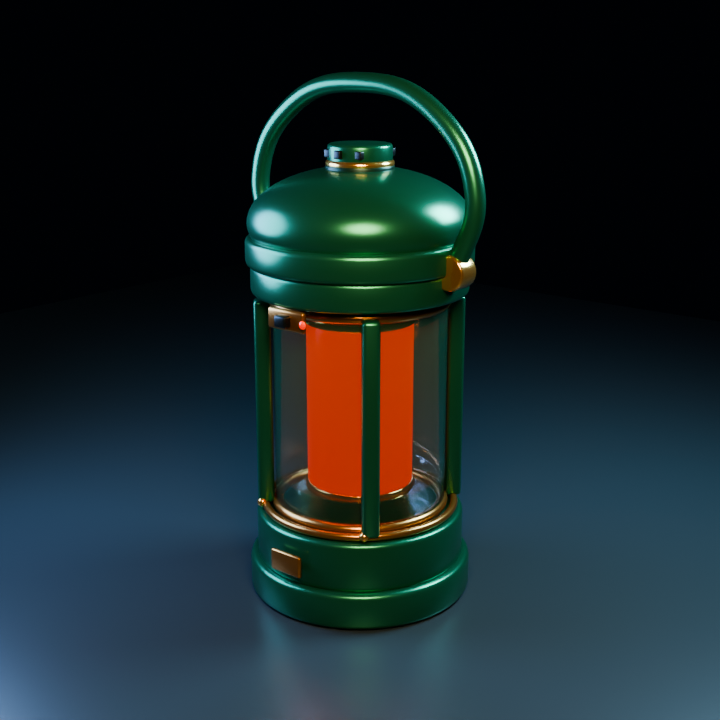
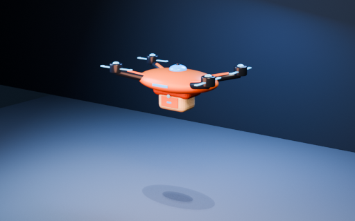

# Forward execution examples

These are two original procedural examples produced from ordinary-language
requests during development. Each began in a fresh agent session that read the
skill and its relevant playbook. Internal agent critiques and repairs followed.
The reviews are `SELF_EVAL_ONLY`; the examples are not an external aesthetic
certification, a measured success rate or proof of every target platform.

| Case | Requested result | Native source and evidence |
|---|---|---|
| Forest-green camping lantern | Finished model, clear glass chamber, warm light, carry handle, brass details and product preview | [Blender source](lantern/forest_green_camping_lantern.blend), [generator](lantern/build_lantern.py), [render script](lantern/render_presentation.py), [receipt](lantern/receipt.json) |
| Orange delivery drone | Looping hover, gentle banks, spinning propellers, moving soft shadow, editable source and video | [Blender source](drone/delivery_drone_hover.blend), [generator](drone/build_drone.py), [6-second video](drone/preview.mp4), [12-second diagnostic video](drone/slow.mp4), [receipt](drone/receipt.json) |

## Lantern



The agent used a hard-surface assembly with a rotational body, separate glass,
an emissive diffuser, curve handle and brass hardware. An internal critique
identified flat emission and transparency stippling. A localized material repair
and a Cycles preview clarified the glass without changing the accepted geometry.
The final native file uses a plausible approximate physical size of about
25.4 by 20.7 by 46.6 cm, marked as inferred rather than measured from a product.

Complementary views: [front](lantern/front.png), [side](lantern/side.png),
[back](lantern/back.png), [top](lantern/top.png). The final hero was rerendered
after unit normalization and independently compared with the earlier hero:
decoded RGB pixels were identical. Complementary images retain the same accepted
geometry/materials from before that metadata-only unit correction.

This is a render-focused asset. Printing, fit, watertightness, UV quality,
character deformation and native game-engine playback are not established.
The beauty script uses a temporary product-lighting rig; the native model also
retains its editable preview camera/lights. Diagnostic and presentation rigs
are recorded separately rather than confused with source geometry.

## Drone



The scene has a named object hierarchy and native layered Actions for hover,
banking, independent rotors and art-directed shadow layers. The original rotor
speed could alias at the 24 FPS preview rate; the agent changed it and inspected
the resulting phases. A visible backdrop edge was repaired before rerendering.
The approximate drone envelope is 36.0 by 26.2 by 12.4 cm.

The unit correction preserved all geometry/motion values. All 144 freshly
rendered frame images were independently compared with the earlier sequence and
had identical decoded RGB pixels. The final helper encodes intended-speed and
slow previews at 6 and 12 seconds. [The pose sheet](drone/contact-sheet.png) and
[propeller details](drone/propeller-detail.png) complement the evaluated timeline.
Chrome playback was exercised and visually sampled at the timestamps in the
receipt; exhaustive continuous viewing is not claimed.

The shadow is intentionally art-directed. This case does not test flight
dynamics, character retargeting, native game controllers, cloud publishing,
network ownership or device performance.

## Replaying the sources

For an agent replay, copy the chosen example folder to a separate working
directory before running the generator. Blender 5.2 was tested; other versions
need an actual capability probe. The lantern generator writes its source next
to the script. Its render script uses `RENDER_ENGINE=cycles` for the published
beauty style. The drone generator takes `--out` after Blender's argument boundary:

```sh
blender --background --factory-startup --python build_drone.py -- --out /absolute/work/drone.blend
```

These sources contain original procedural geometry and materials, with no
downloaded motion libraries, third-party textures or proprietary weights.
Artifact hashes, repairs, assumptions and observed limits live in each receipt.
